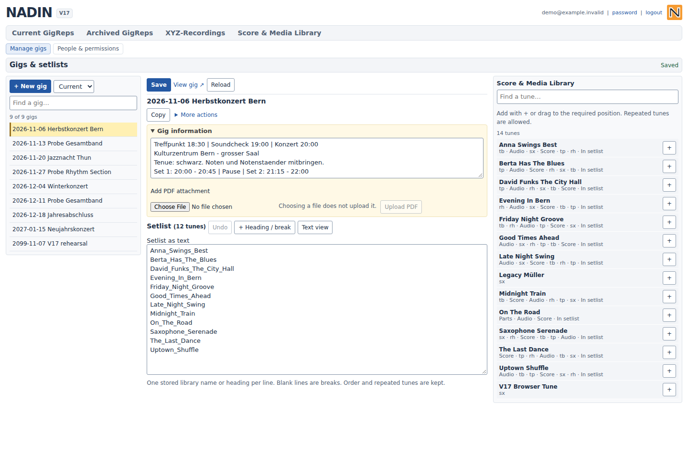
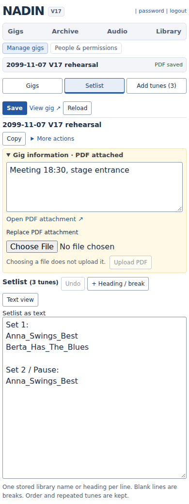
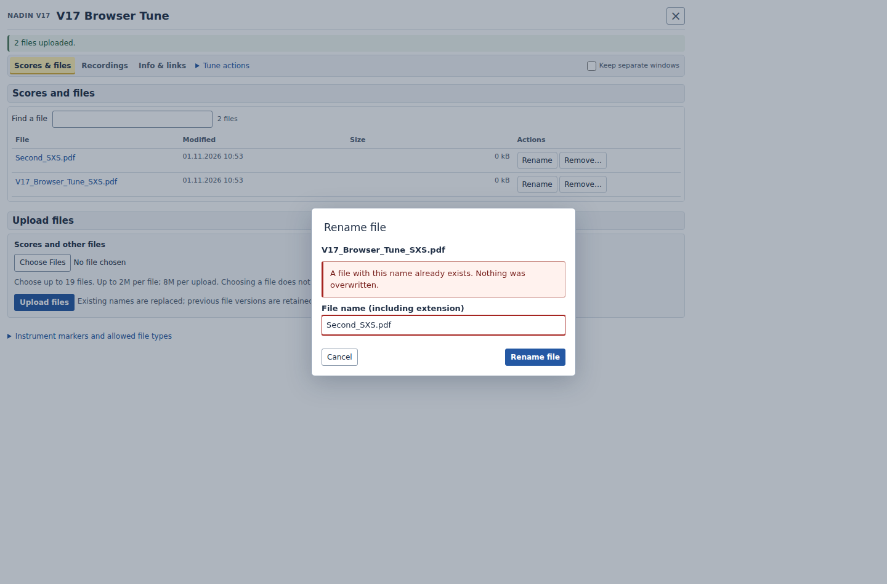

# V17 — executed verification

Executed on 1 November 2026 against disposable installations and synthetic band data. No production installation was changed and no member mail was sent. Base: V16 `ab802d7e39cab199b3b8090fe19d62b5d8c24792`, retaining the compact ZIP links and the current guided forScore export.

## Runtime and browser results

| Environment | Executed scope | Result |
| --- | --- | --- |
| PHP 8.3.6 | 168 application/test PHP syntax checks; complete inherited and expanded runtime suite | Passed |
| PHP 8.3.6, strict future-error guard | Complete HTTP/core/DOM suite with warnings treated as errors and selected removed/deprecated APIs disabled | Passed; this is a simulation, not a native PHP 9 runtime |
| PHP 8.5.12 | 168 syntax checks, 215 core compatibility/authentication/member/encoding checks and 34 V17 HTTP task checks | Passed for this subset |
| Chromium 153.0.8010.0 | 80 V17 end-to-end checks; actual login, file operations, administration, keyboard, mobile panels and forScore download | Passed; no unhandled JavaScript errors or PHP warnings/errors/deprecations in the V17 scenarios |
| Chromium 153 | 25 axe-core scans across member views, administration, task windows, account screens and standalone gig preview | No violations returned for the selected WCAG A/AA tags, including 2.1/2.2 |
| Inherited browser/DOM coverage | 24 native interaction/layout checks, 22 native forScore workflow checks, 78 administration DOM checks, 8 login DOM checks, 49 forScore workflow DOM checks | Passed |
| GigRep position regression | 99 HTTP and 336 DOM checks across current/archive views, roles, configured position and width | Passed again after the standalone preview correction |

The PHP 8.5 build used here is minimal and does not provide cURL, DOM or ZipArchive. Federation and archive integration were executed under PHP 8.3 with the committed optional dependency versions. The earlier V16 runtime preparation remains inherited; this report does not extend the PHP 8.5 subset to unexecuted integrations.

## Actual workflows and failure cases

- Create a tune and continue directly to its scores. Invalid or duplicate names keep an editable form and useful error; a native POST response offers the next action too.
- Choose multiple PDFs without writing anything; explicitly upload and compare exact stored bytes. Validate a whole invalid batch before replacing files. Keep prior versions on replacement. Accept MP3 filename extensions irrespective of case and retain the established gig-attachment path.
- Rename a file into an existing name: report the collision, preserve both original files and retain the proposed name. Retry successfully. Cancel removal with Escape; confirmed removal retains the bytes in deleted files.
- Save notes twice using the returned revision. Hold a real browser request pending and protect the submitted fields until completion. Reject a concurrent stale write while keeping the full draft. Keep editing and Discard operate on the same editor.
- Refresh an uploaded file list in an actual Latin-1 folder; retain its original `%FC` path bytes. Existing 89-check HTTP/JavaScript encoding coverage remains green.
- Build a gig on a phone: switch working areas without replacing the draft, add repeated tunes, use text editing and Undo, retain headings, breaks and source order through an actual save. A failed Save and continue reveals the editor; the error link focuses the invalid field.
- Select a gig PDF without uploading it. Save and upload persists the current gig first. Keep editing retains an unuploaded File; upload and continue finishes that attachment before changing gigs.
- Create a temporary substitute, select section rights, save, filter expired accounts and search the roster. Destructive account confirmation starts at Cancel. Initial access passwords remain collapsed individually.
- Change forScore import intent, refresh the signed preview and download a real `.4ss` file. The expanded 90-check forScore HTTP suite also covers remembered sections, reference-only export, ambiguity, inventory, headings and identity behaviour.
- Exercise all active task windows and upload aliases at 320 px, including long tune names, score/audio/attachment lists, notes, rename/remove/create, access details, login, access request, password change/reset, timeout and gig preview. No horizontal page overflow in these cases. The preview's mobile music menu works without a sidebar and Escape restores focus.

The broader suite also passes 108 administration HTTP/storage checks, the shared-directory/symlink installation scenario, 32 ZIP integrity/concurrency checks, 54 federation signature/storage checks, 39 isolated TLS OIDC/SAML checks, 56 account HTTP checks, 53 login-protection checks, 41 V16 regressions, 43 main-behaviour parity checks, and the compatibility/final-review tests. Rights, CSRF, revision conflicts, file identities, literal headings, custom markers and exact archive contents remain exercised.

A page view also preserves a pre-existing data file named `x`: V17 replaces the old destructive create/delete permissions probe with a read-only check.

## Reproduction

The runtime harness needs Python `requests`, `beautifulsoup4` and `cryptography`, plus Node `jsdom`. Browser checks additionally need Playwright, axe-core and an installed Chromium. Optional federation integration needs `composer install` using the committed lock file. Test dependencies are not deployed with the application.

```sh
NADIN_PHP=/path/to/php NADIN_WORKFLOW_DOM=1 python tests/check-runtime.py
NADIN_PHP=/path/to/php python tests/check-runtime.py --simulate-php9
NADIN_PHP=/path/to/php NADIN_CHROMIUM=/path/to/chromium NADIN_WORKFLOW_DOM=1 NADIN_WORKFLOW_BROWSER=1 python tests/check-runtime.py
```

Set `NODE_PATH` if test dependencies are installed outside the repository. `NADIN_SCREENSHOTS` selects the browser evidence directory. The harness creates and removes disposable data and starts local test servers; it must not point at a production installation.

## Evidence and limits

The [machine-readable accessibility/journey result](V17-browser-results.json) records all 25 scanned states. The examples below are actual Chromium renders of the synthetic fixture, not design mockups.

These checks do not constitute a WCAG certification, user study, native iPad/Safari/forScore import test, screen-reader session or production identity-provider validation. Complete the corresponding acceptance checks on the intended band's devices and hosting before adopting the development branch in production.






